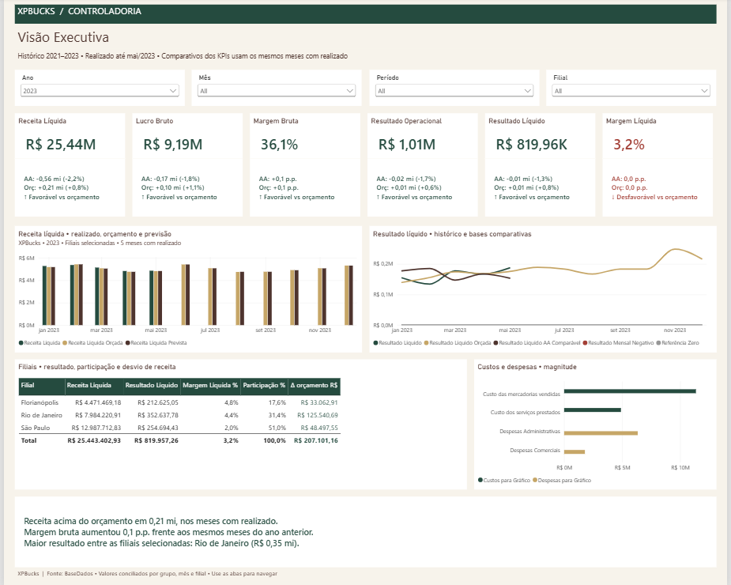
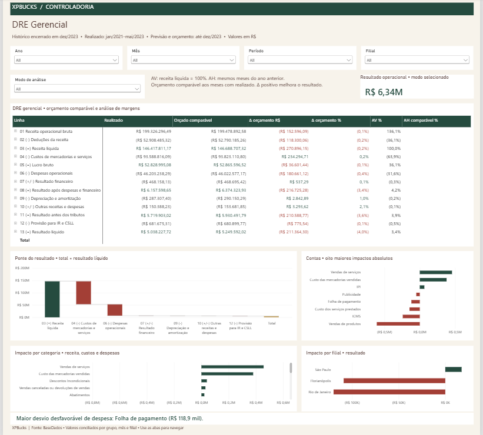
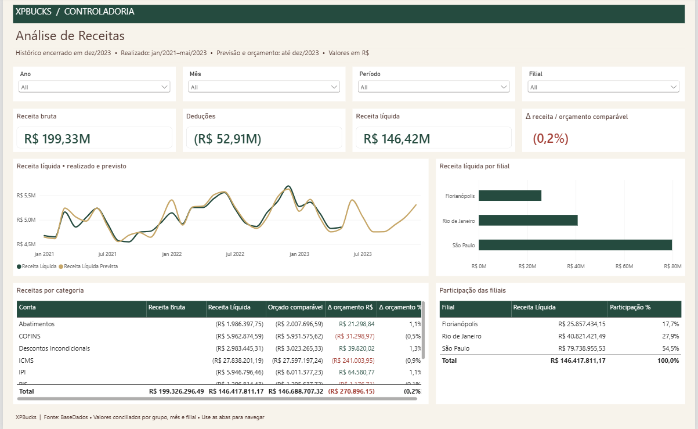
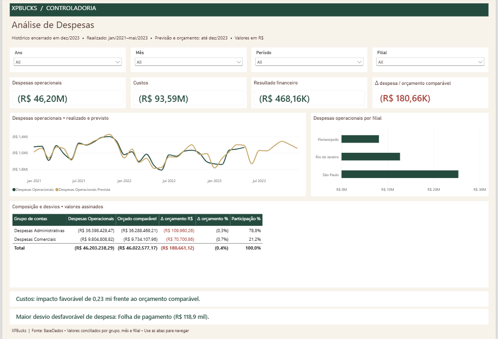
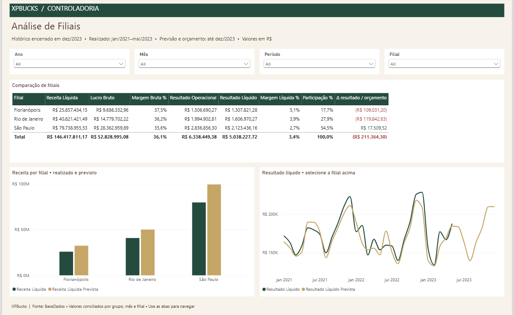

# DRE Moderno — Controladoria XPBucks (Power BI)

Relatório gerencial de DRE para a diretoria da XPBucks: receita, despesas, margens, resultado líquido, comparação entre filiais (São Paulo, Rio de Janeiro e Florianópolis) e desvios contra orçamento, previsão e ano anterior. O projeto está em formato **PBIP** (relatório PBIR + modelo TMDL), versionável em texto, e cada número do relatório foi conciliado contra a planilha de origem por testes automatizados.

| Visão Executiva | DRE Gerencial |
|---|---|
|  |  |

| Receitas | Despesas | Filiais |
|---|---|---|
|  |  |  |

## Destaques

- **DRE em 13 linhas** com subtotais nativos, modos *Seleção / Acumulado no ano / Ano completo*, análise vertical (AV) e horizontal (AH).
- **Comparações honestas:** o orçamento e o ano anterior usam apenas os meses que têm realizado. O realizado termina em mai/2023, então nenhum KPI compara cinco meses de realizado com doze de orçamento, e a falta de dado aparece em branco, nunca como queda de 100%.
- **Cascata do resultado** que fecha exatamente no resultado líquido, Top 8 desvios por conta e insights textuais gerados por DAX.
- **Star schema enxuto:** 9 tabelas, 10 relacionamentos 1:\* unidirecionais e uma única fato de realizado, alimentada por 9 consultas de staging sem carga.

## Modelo de dados

| Tabela | Papel | Granularidade |
|---|---|---|
| `fLancamentos` | Realizado (união das 9 abas de origem) | competência mensal × conta × filial: 3.741 linhas, jan/2021–mai/2023 |
| `fOrcamento`, `fPrevisao` | Cenários planejados | mesma granularidade: 4.644 linhas cada, jan/2021–dez/2023 |
| `dPlanoConta` | Contas, sinal (`tipoLancamento`) e grupo DRE | 129 contas |
| `dEstruturaDRE` | Máscara gerencial da DRE | 39 linhas |
| `dFilial` | Filiais | 3 |
| `dCalendario` | Calendário marcado como tabela de datas, gerado a partir das fatos | 1.095 dias (2021–2023) |
| `dDRE`, `dPeriodo` | Seletores de apresentação (sem relacionamento) | 13 linhas / 3 modos |

Os valores são assinados pela natureza da conta (`valor × tipoLancamento`): receitas são positivas e custos/despesas negativos, então um impacto orçamentário positivo é sempre favorável. As regras completas estão em [docs/regras-negocio.md](docs/regras-negocio.md) e o catálogo de medidas em [docs/medidas-executivas.md](docs/medidas-executivas.md).

## Como abrir

1. Instale o **Power BI Desktop** (versão recente com suporte a projetos PBIP).
2. Clone o repositório. Se clonar em `C:\Projetos\PowerBI\ProjetoBI`, o projeto abre e atualiza sem nenhum ajuste.
3. Em outro caminho: abra `DRE Moderno.pbip` e vá em **Página Inicial → Transformar dados → Editar parâmetros**. Informe em `pArquivoBase` o caminho **absoluto** de `data/processed/BaseDados_Tratada.xlsx` (o Power Query não aceita caminho relativo) e clique em **Atualizar**.

Todas as consultas leem a planilha apenas pelo parâmetro `pArquivoBase`; não há outro caminho fixo no modelo.

**Fonte dos dados:** base do desafio de DRE do curso de análise de dados da **Xperiun**, publicada com autorização. A empresa XPBucks e o briefing de negócio fazem parte do desafio. `scripts/prepare_workbook.py` gera a cópia tratada a partir da planilha original, sem alterá-la: remove linhas vazias e colunas sem cabeçalho e preserva os códigos de conta como texto.

## Data Validation & Quality Assurance

Um dashboard só é útil se os números estiverem certos. Por isso, cada camada foi validada de forma **independente da implementação**: os valores esperados são recalculados em Python (com `Decimal`) direto da planilha original e comparados com o modelo em execução no Power BI Desktop, via consultas DAX somente leitura.

| Camada | O que é verificado | Resultado |
|---|---|---|
| Origem → cópia tratada | Todas as chaves, datas e valores das 12 tabelas mensais | 188 combinações tabela/competência idênticas; diferença máxima de R$ 0,0000000005 |
| Cobertura histórica | Se a ausência de realizado após mai/2023 é da fonte ou do modelo | Confirmada na própria origem, nas 3 filiais; não é falha de carga, relacionamento ou filtro |
| Agregações financeiras | Realizado, orçamento e previsão por grupo DRE × mês × filial | **2.424 agregações** conciliadas; diferença máxima de R$ 0,00000001 (tolerância R$ 0,01) |
| Linhas da DRE | As 13 linhas e todos os subtotais, por mês e filial | **2.535 resultados** conciliados |
| DRE nos três modos | Realizado, orçamento comparável, AA, impacto, AV e AH | **29.484 verificações** em 4.212 contextos |
| KPIs executivos | Comparativos AA/orçamento por ano, mês, filial e consolidado | **4.992 verificações** em 156 contextos; diferença máxima < R$ 0,00000005 |
| Contas e insights | Impacto de cada uma das 43 contas, ranking Top 8 e pior desvio de despesa | Conciliados ao Excel |
| Casos de borda | Mês sem realizado, ano sem base anterior, denominador zero | 324 verificações em 108 contextos: retorno em branco, nunca −100% |
| Medidas | Todas as 144 medidas no total, por ano e por filial | Avaliam sem erro |
| Modelo (TMDL) | Desserialização pelo TOM oficial, tabela de datas, cardinalidade, direção e tipos dos relacionamentos | Aprovado: 9 tabelas, 10 relacionamentos |
| Relatório (PBIR) | Schemas oficiais da Microsoft e referências de cada visual ao modelo | Aprovado |
| Renderização | 5 páginas abertas no Desktop, filtros de ano e de filial/mês exercitados | Inspecionado visualmente |

**Defeitos que os testes pegaram e que foram corrigidos:** *Crescimento Receita %*, *Variação YoY %* e *DRE AH %* retornavam −100% em meses sem realizado; agora retornam em branco. Uma versão inicial das consultas M tinha tipos sem o prefixo `type`, corrigida antes dos testes funcionais.

**Regressão da simplificação do modelo (09/11/2026):** as 9 tabelas intermediárias viraram staging sem carga e 8 tabelas legadas foram removidas (`scripts/simplify_model.py`). Depois da atualização completa no Desktop, as conciliações de DRE e de calendário e a avaliação das 144 medidas passaram sem nenhuma diferença.

### Reproduzir

```powershell
python -m venv .venv
.\.venv\Scripts\python.exe -m pip install -r tests/requirements.txt
.\.venv\Scripts\python.exe scripts/validate_project.py         # JSON, schemas PBIR e referências
pwsh -File scripts/validate_tmdl.ps1                            # desserialização TMDL via TOM (.NET 8)

# Com o projeto aberto no Desktop (porta e banco da instância local):
pwsh -File tests/check_dre_live.ps1      -Port <porta> -Database <id>
pwsh -File tests/check_calendar_live.ps1 -Port <porta> -Database <id>
pwsh -File tests/check_measures_live.ps1 -Port <porta> -Database <id>
```

`scripts/setup_tom.py` baixa as bibliotecas oficiais da Microsoft (TOM/ADOMD) para uso local, sem instalação global. Os testes que releem a planilha original precisam da variável `DRE_SOURCE_XLSX` com o caminho dela. Detalhes em [tests/README.md](tests/README.md) e [docs/auditoria-dax-cobertura.md](docs/auditoria-dax-cobertura.md).

**Limites declarados:** a validação comprova que o relatório reproduz fielmente a base e as regras documentadas. Não substitui uma auditoria contábil da fonte. Publicação no Power BI Service e no app mobile não foi testada. O schema remoto de `.pbi/localSettings.json` retorna HTTP 404 no servidor da Microsoft, então esse arquivo fica sem validação de schema.

## Estrutura

```text
├── DRE Moderno.pbip
├── DRE Moderno.Report/          # relatório PBIR: 5 páginas
├── DRE Moderno.SemanticModel/   # modelo TMDL: tabelas, medidas, relacionamentos, Power Query
├── data/processed/              # base tratada usada pelo parâmetro pArquivoBase
├── docs/                        # regras de negócio, dicionário, medidas, auditorias e testes
├── scripts/                     # preparação da base, validações, migrações e exportação
└── tests/                       # conciliações independentes (Python e PowerShell)
```

Documentação: [regras de negócio](docs/regras-negocio.md) · [dicionário de dados](docs/dicionario-dados.md) · [catálogo de medidas](docs/medidas-executivas.md) · [auditoria de cobertura e DAX](docs/auditoria-dax-cobertura.md).

## Como foi desenvolvido

Projeto desenvolvido por mim com apoio de assistentes de IA na geração de código PBIR/TMDL, DAX e scripts de teste. A definição das regras de negócio, as decisões de modelagem e a revisão e validação dos resultados no Power BI Desktop foram conduzidas por mim. O modelo foi construído em formato PBIP justamente para que cada mudança fique rastreável em texto.

## Autor

**Isaias Oliveira** · [LinkedIn](https://www.linkedin.com/in/isaias-oliveira-a4086558/)

## Licença

Código, definições do projeto Power BI, scripts e documentação sob a [licença MIT](LICENSE). Os dados em `data/processed/` **não** estão cobertos pela MIT: pertencem ao desafio da Xperiun e são publicados com autorização, apenas para estudo e portfólio.
